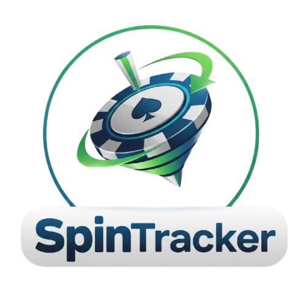
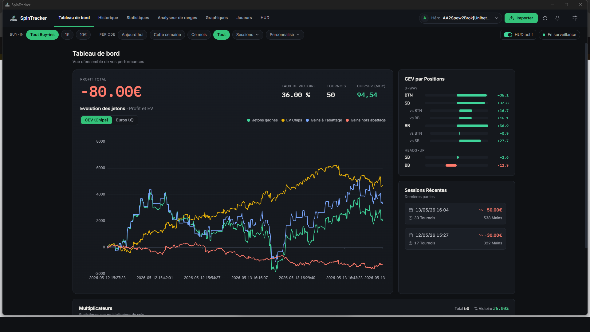
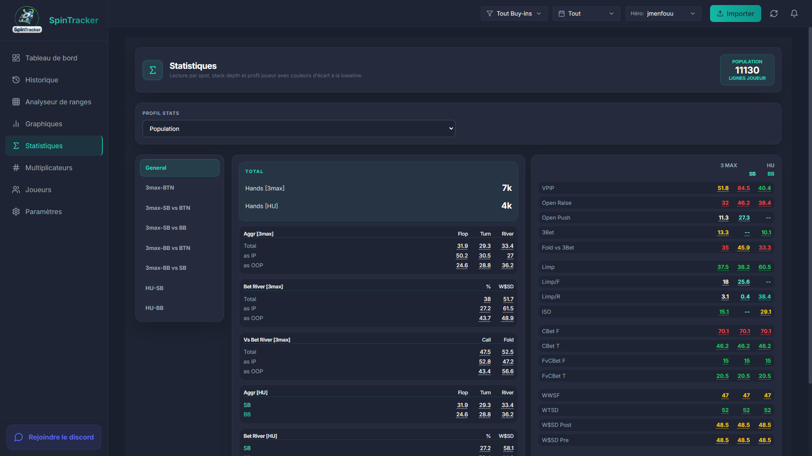
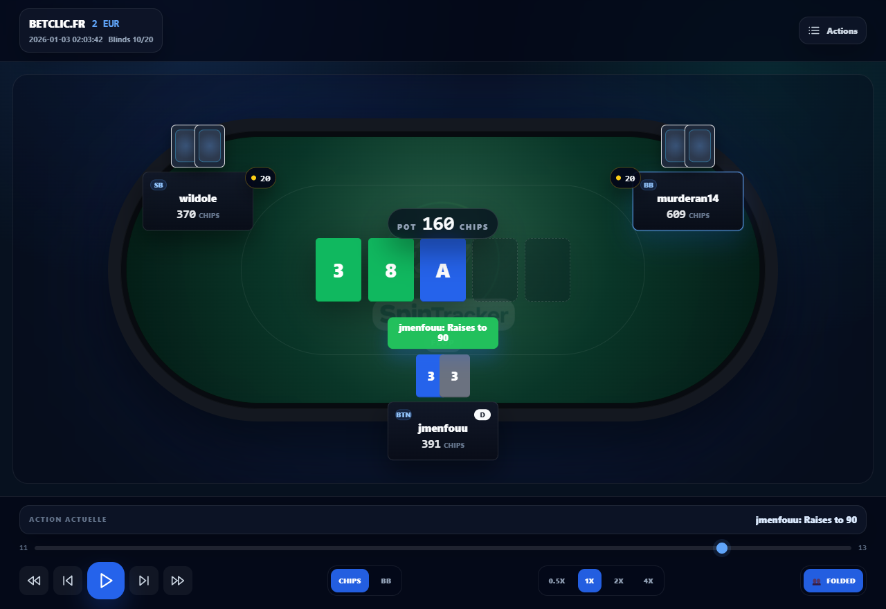
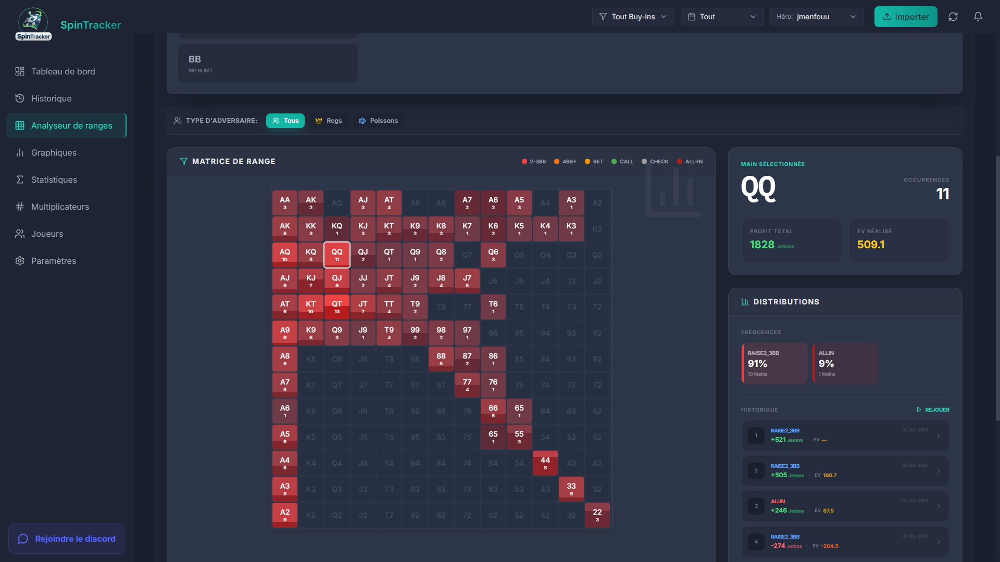
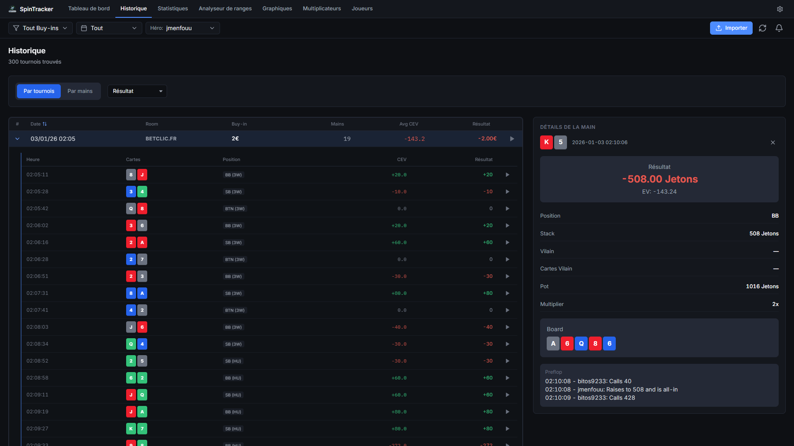

<div align="center">



# SpinTracker

**The free, open-source poker tracker for Spin & Go tournaments.**

Import your hand histories, find your leaks, replay your hands and study ranges — 100% local, no account, no subscription.

[](https://github.com/florentvdry/spintracker/releases/latest)
[](https://github.com/florentvdry/spintracker/releases)
[](LICENSE)
[](https://github.com/florentvdry/spintracker/stargazers)
[](CONTRIBUTING.md)

[**Download**](https://github.com/florentvdry/spintracker/releases/latest) ·
[**Website**](https://spintracker.com) ·
[**Report a bug**](https://github.com/florentvdry/spintracker/issues/new/choose) ·
[**Contribute**](CONTRIBUTING.md)



</div>

---

## What is SpinTracker?

SpinTracker is a **free and open-source poker tracker built for Spin & Go players**. It reads the hand histories saved by your poker room, stores them in a local SQLite database on your computer, and turns them into statistics, leak detection, EV analysis, a hand replayer and a range research tool.

It is a free alternative to paid poker trackers for 3-max Spin & Go, Heads-Up and multiplier-based formats.

> Your data never leaves your machine. There is no cloud, no account and no telemetry.

## Features

| | |
|---|---|
| 📊 **Dashboard** | Recent sessions, winrate chart and global statistics at a glance. |
| 🗂️ **Hand & tournament history** | Browse every hand and tournament with filters by player, position, street, stakes and more. |
| 📈 **Detailed statistics** | Stats by spot, stack depth and player profile, compared with a baseline to highlight your **leaks**. |
| 🎬 **Interactive hand replayer** | Replay hands street by street, check equities, take notes on opponents. |
| 🧮 **Range research** | Interactive 13×13 range grid to study your ranges and compare them with opponent tendencies. |
| 🎰 **Multipliers analysis** | Break down your results by Spin multiplier. |
| 👥 **Player database** | Overview of every opponent you faced and how they play. |
| 🔄 **Automatic import** | Detects the room and imports hand histories idempotently — re-importing never creates duplicates. |
| 🌍 **Multilingual UI** | English and French, easy to extend. |

SpinTracker is a post-session analysis tool: it is **not** a real-time HUD overlay.

### Supported poker rooms

| Room | Status |
|---|---|
| Winamax | ✅ Supported |
| Betclic | ✅ Supported |
| Unibet | ✅ Supported |
| More rooms | 💡 Requests and parser contributions welcome |

Missing your room? [Open a room support request](https://github.com/florentvdry/spintracker/issues/new?template=room_support.yml) or see [Adding or fixing a parser](CONTRIBUTING.md#adding-or-fixing-a-parser).

## Screenshots

<table>
  <tr>
    <td></td>
    <td></td>
  </tr>
  <tr>
    <td></td>
    <td></td>
  </tr>
</table>

## Installation

1. Download the latest `SpinTracker-Setup-<version>.exe` from the [**Releases page**](https://github.com/florentvdry/spintracker/releases/latest).
2. Run the installer (Windows 10 or later, 64-bit).
3. Open SpinTracker and import your poker room's hand history files.

SpinTracker updates itself automatically when a new release is published. macOS and Linux builds are not available yet — contributions are welcome.

## Build from source

### Prerequisites

- [Node.js](https://nodejs.org/) (LTS)
- [.NET 8 SDK](https://dotnet.microsoft.com/download/dotnet/8.0)
- Windows (the dev scripts and installer currently target Windows)

### Setup and run

```bash
git clone https://github.com/florentvdry/spintracker.git
cd spintracker
npm run setup          # installs dependencies and builds the backend
npm run dev:electron   # recommended: Vite + Electron + C# backend
```

| Command | Description |
|---|---|
| `npm run dev:electron` | Full desktop dev mode (frontend on `:3000`, backend on `:5050`) |
| `npm run dev` | Backend and frontend in a browser (some features need Electron IPC) |
| `npm run react:dev` | Frontend only (Vite) |
| `npm run backend:dev` | Backend only, hot reload |
| `npm run build` | Build the Windows installer |
| `cd backend && dotnet test Tests/SpinTrackerBackend.Tests.csproj` | Run backend tests |

## Architecture

```
backend/        ASP.NET Core (.NET 8) API — parsing, import, stats, SQLite, FluentMigrator
  Controllers/  HTTP endpoints
  Services/     Application logic
  Engines/      Analytics: stats, equity, EV, leaks
  Parsers/      One parser per poker room
  Data/         Repositories (SQLite)
  Migrations/   Database migrations
frontend-vue/   Vue 3 + Vite + Tailwind + Pinia UI
main.js         Electron main process (launches the backend on port 5050)
website/        Landing site (Next.js)
```

**Tech stack:** Electron · Vue 3 · Vite · TailwindCSS · Pinia · C# / ASP.NET Core (.NET 8) · SQLite · FluentMigrator.

More details in [backend/README.md](backend/README.md) and [AGENTS.md](AGENTS.md).

## Contributing

SpinTracker is open source and contributions of all kinds are welcome: bug reports, new room parsers, translations, UI improvements, documentation.

- Read the [contributing guide](CONTRIBUTING.md)
- Look for issues labeled [`good first issue`](https://github.com/florentvdry/spintracker/labels/good%20first%20issue) or [`help wanted`](https://github.com/florentvdry/spintracker/labels/help%20wanted)
- Ask questions in [Discussions](https://github.com/florentvdry/spintracker/discussions)

Please follow our [Code of Conduct](CODE_OF_CONDUCT.md). For vulnerabilities, see [SECURITY.md](SECURITY.md).

> ⚠️ **Never attach real hand histories containing player names or personal data to issues.** Anonymize them first.

## FAQ

**Is SpinTracker free?** Yes. It is MIT-licensed: free to use, modify and redistribute.

**Is it a HUD?** No. It analyzes your hands after your sessions (stats, leaks, replayer, ranges); it does not overlay the poker table.

**Is it allowed by poker rooms?** SpinTracker only reads the hand history files your room already saves on disk. Always check your room's terms of service regarding tracking software.

**Where is my data stored?** In a local SQLite database on your machine. Nothing is uploaded.

## License

[MIT](LICENSE) © SpinTracker contributors.

SpinTracker is not affiliated with, endorsed by or sponsored by Winamax, Betclic, Unibet or any other poker operator. All trademarks belong to their respective owners.

<sub>Keywords: poker tracker, Spin & Go tracker, hand history analyzer, poker leak finder, poker replayer, range analyzer, Winamax, Betclic, Unibet, open source poker software, free poker tracker.</sub>
